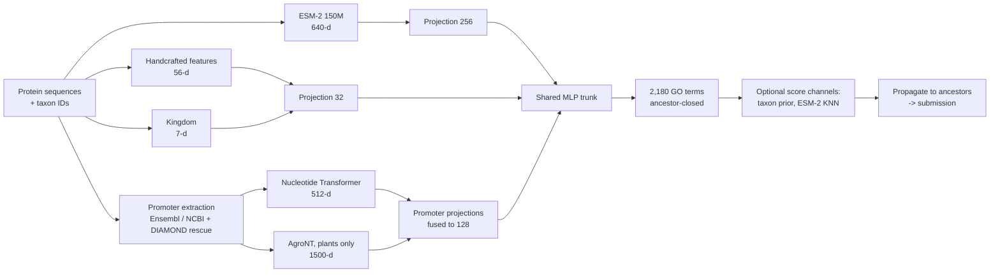

# CAFA6 protein function prediction

Predicting Gene Ontology (GO) terms for proteins in the
[CAFA6 Kaggle challenge](https://www.kaggle.com/competitions/cafa-6-protein-function-prediction).
A multi-label neural network combines a protein language model (ESM-2) with handcrafted
sequence features, taxonomy, and embeddings of each gene's **promoter DNA**. A controlled
ablation measures what each feature group adds, scored with ROC-AUC and the official CAFA
evaluator.

<!-- results:start -->
**Results:** 6 feature configurations and 24 architectures, 3 seeds each, scored on a held-out
split and with the official CAFA evaluator on the CAFA6 final release.

- **ESM-2 carries the signal.** It adds +0.065 official weighted Fmax (p < 0.001). Handcrafted
  and kingdom features improve ranking (AUC), but not the official CAFA score.
- **Promoter DNA embeddings improve per-term ranking but hurt the official score.**
  - Macro ROC-AUC rises on every seed.
  - On the prospective CAFA6 targets, the promoter model is significantly *worse* than every
    ESM-2 model without promoters: −0.010 to −0.014 weighted Fmax, p ≤ 0.006, paired protein
    bootstrap.
  - Promoter coverage is much patchier on those targets than in training.
- **Promoters help "response to …" terms most,** as hypothesised: twice the gain of other
  processes without ESM-2 (p = 0.0001). With ESM-2 that extra benefit largely disappears.
- **A random holdout picks the wrong model.** Internally the promoter model looks best, and
  officially it ranks last of the ESM-2 models.

| Model | Features | Official weighted Fmax | Official macro AUC | Internal Fmax |
|---|---|---|---|---|
| default architecture | ESM-2 | 0.319 ± 0.006 | 0.838 ± 0.003 | 0.451 ± 0.002 |
| default architecture | ESM-2 + handcrafted + kingdom | 0.321 ± 0.003 | 0.844 ± 0.006 | 0.457 ± 0.002 |
| default architecture | + promoters | 0.313 ± 0.002 | **0.850 ± 0.002** | 0.457 ± 0.001 |
| wider architecture (search) | + promoters | 0.321 ± 0.004 | **0.850 ± 0.008** | **0.467 ± 0.004** |
| **wider architecture (search)** | **ESM-2 + handcrafted + kingdom** | **0.326 ± 0.008** | 0.844 ± 0.003 | 0.464 ± 0.002 |

The last row is the best model on the official evaluation. In the protein bootstrap it beats rows
2–4 (the other architecture × promoter combinations) on weighted Fmax (p = 0.001–0.042).
- **Feature ablation, significance and the promoter analyses:** [results/](results/README.md).
- **Architecture search and the final comparison:** [results/hparam-search/](results/hparam-search/README.md).
<!-- results:end -->

## Approach



**Feature groups.** Each is built separately, keyed by protein ID, so it can be rebuilt or
dropped on its own. See [docs/features.md](docs/features.md).

| Group | Dim | What it captures | Coverage |
|---|---|---|---|
| ESM-2 150M embedding | 640 | evolutionary and structural signal learned from protein sequence | all proteins |
| Handcrafted | 56 | ProtParam biophysics, topology heuristics, terminal motifs, PROSITE patterns, amino-acid composition | all proteins |
| Kingdom | 7 | coarse taxonomy from NCBI | all proteins |
| Promoter, NT-v2 100M | 512 | the 3 kb upstream of each protein's gene, embedded with a multi-species DNA model | 97% train / 88% test |
| Promoter, AgroNT 1B | 1500 | the same promoters embedded with a plant genome model | plants only |

Promoters come from Ensembl and NCBI genomes for 55 anchor species. Proteins without a direct
gene link are rescued by DIAMOND alignment, labelled as an exact (same-taxon) or proxy
(same-phylum) match. The remaining gaps are imputed from the nearest training proteins in
ESM-2 space.

**Model.**
- One projection per feature group feeds a shared MLP that predicts the 1,000 most frequent
  terms plus all their ancestors.
- Training uses class-weighted BCE, with early stopping on IA-weighted CAFA Fmax.
- Predictions are propagated up the ontology before scoring.
- Two optional score channels can be blended in per aspect: an exact-taxon prior and ESM-2
  nearest-neighbour label transfer.

See [docs/modeling.md](docs/modeling.md).

**Evaluation.**
- **Internal:** 20% of labelled proteins are held out (seeded). Metrics are macro/micro ROC-AUC
  and protein-centric, IA-weighted Fmax per aspect.
- **Official:** predictions for the [released CAFA6 ground truth](https://doi.org/10.6084/m9.figshare.32861969)
  are scored with the [CAFA evaluator](https://github.com/claradepaolis/CAFA-evaluator-PK) under
  its three settings:
  - no knowledge (NK);
  - limited knowledge (LK);
  - partial knowledge (PK).

  It reports weighted Fmax, weighted micro-F and S-min; ROC-AUC is computed against the same
  truth.

## Quickstart

Requires Python 3.12+ and [uv](https://docs.astral.sh/uv/). Data is never committed; the
scripts below download or rebuild it. See [docs/DATA.md](docs/DATA.md).

```bash
uv sync
scripts/data/03_tools.sh                  # cafaeval, kaggle, diamond
scripts/data/01_competition.sh            # Kaggle data (needs a Kaggle API token)
scripts/data/02_ground_truth.sh           # CAFA6 ground truth from Figshare, checksum-verified
scripts/data/04_features.sh all           # every feature block (long: genomes and DNA models)

uv run cafa6-train-multilabel-nn --top-n 1000 --output-dir data/models/nn_1000
uv run cafa6-predict-multilabel-nn data/models/nn_1000 --output data/submissions/nn_1000.tsv
uv run cafa6-evaluate data/submissions     # official CAFA scores for every file in the folder
```

## Reproducing the ablation

```bash
uv run cafa6-ablation run --sweep feature-groups             # 6 configs x 3 seeds, ROC-AUC scored (~3.5 h on an M4 Pro)
uv run cafa6-ablation cafaeval --sweep feature-groups --best # official CAFA evaluator on the best config (~20 min per seed)
uv run cafa6-ablation report --sweep feature-groups          # tables and figures -> results/
```

Each run trains with the score channels off, so only the feature groups differ. Seeds are shared
across configs, so every comparison is paired.
- **Every run** is scored by ROC-AUC, on the internal holdout and against the CAFA6 truth.
- **The official evaluator** costs about 20 minutes per run, so it runs only on the config with
  the best internal score. Predictions for every run are kept, so
  `cafa6-ablation cafaeval --sweep feature-groups` can score the rest later. The write-up in [results/README.md](results/README.md)
is produced with the `document-results` Claude Code skill
([.claude/skills/document-results](.claude/skills/document-results/SKILL.md)).

## Repository layout

```text
src/feature_engineering/   feature blocks: embeddings, handcrafted, taxonomy, promoters/
src/modeling/              data assembly, NN trainer and predictor, XGBoost baseline,
                           GO evaluation, official scoring, ablation runner and report
scripts/                   data download and rebuild (scripts/data/), repo utilities
tests/                     unit tests (uv run pytest)
docs/                      data sources, feature and model details
results/                   committed ablation tables, figures and write-up
notebooks/                 ESM-2 vs handcrafted feature EDA
```

## Status and future work

- **Dropped:** homolog-transferred expression features (OrthoDB plus expression atlases). They
  needed a manual upload step and had thin coverage outside model organisms.
- **Next:**
  - ensemble the network with the per-term XGBoost baseline;
  - label-embedding / GO-graph output layers;
  - larger ESM-2 checkpoints.
