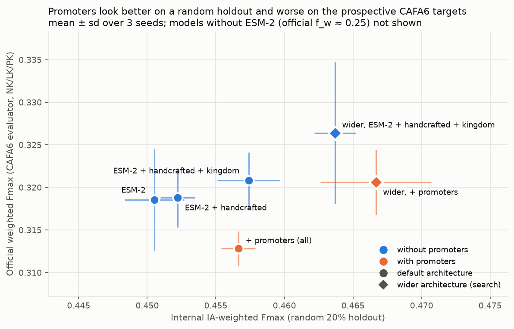
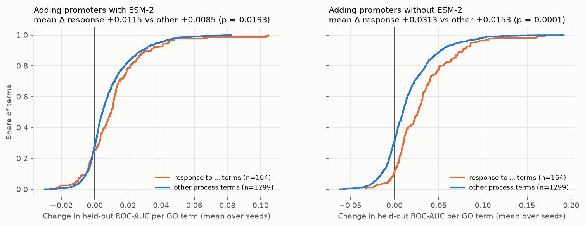
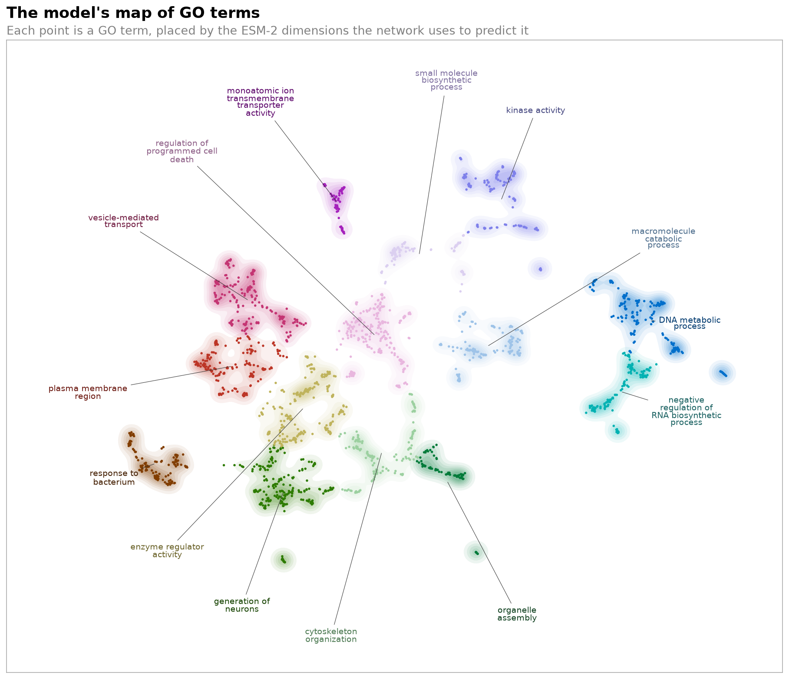
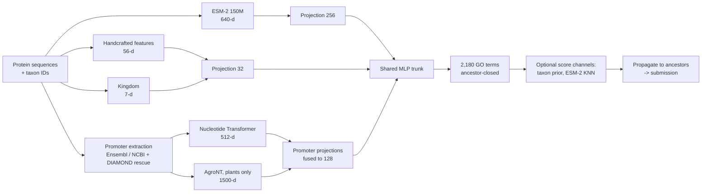

# CAFA6 protein function prediction

Predicting Gene Ontology (GO) terms for proteins in the
[CAFA6 Kaggle challenge](https://www.kaggle.com/competitions/cafa-6-protein-function-prediction).
A multi-label neural network combines a protein language model (ESM-2) with handcrafted
sequence features, taxonomy, and embeddings of each gene's **promoter DNA**. A controlled
ablation measures what each feature group adds, scored with ROC-AUC and the official CAFA
evaluator.

<!-- results:start -->
## Results

Six feature configurations and a 24-trial architecture search were run, each final model on 3
seeds. Every model was scored on a random 20% holdout and with the official CAFA evaluator on the
[CAFA6 final release](https://doi.org/10.6084/m9.figshare.32861969) (8,023 proteins annotated
after training).

- **ESM-2 carries the signal:** +0.065 official weighted Fmax over handcrafted + kingdom features
  alone (p < 0.001).
- **Promoter DNA embeddings help ranking but hurt the official score.**
  - They raise per-term ROC-AUC on every seed.
  - On the CAFA6 targets the promoter model is significantly *worse* than every ESM-2 model
    without promoters: −0.010 to −0.014 weighted Fmax, p ≤ 0.006, paired protein bootstrap.
  - Promoter coverage is much patchier for those targets than for training proteins.
- **Promoters help "response to …" GO terms most,** as hypothesised for expression-driven
  processes: twice the gain of other processes without ESM-2 (p = 0.0001). Most of that signal
  is already captured by ESM-2.
- **A random holdout would have picked the wrong model.** The best internal models include
  promoters. The best model on the official targets is a wider network on ESM-2 + handcrafted +
  kingdom features without promoters: weighted Fmax **0.326**, against 0.313 for the default
  architecture with all features.



| Architecture | Features | Official weighted Fmax | Official macro AUC | Internal Fmax |
|---|---|---|---|---|
| default | ESM-2 | 0.319 ± 0.006 | 0.838 ± 0.003 | 0.451 ± 0.002 |
| default | ESM-2 + handcrafted + kingdom | 0.321 ± 0.003 | 0.844 ± 0.006 | 0.457 ± 0.002 |
| default | + promoters | 0.313 ± 0.002 | **0.850 ± 0.002** | 0.457 ± 0.001 |
| wider (search) | + promoters | 0.321 ± 0.004 | **0.850 ± 0.008** | **0.467 ± 0.004** |
| **wider (search)** | **ESM-2 + handcrafted + kingdom** | **0.326 ± 0.008** | 0.844 ± 0.003 | 0.464 ± 0.002 |

Values are mean ± sd over 3 seeds. In the protein bootstrap the last row beats rows 2–4 on
official weighted Fmax (p = 0.001–0.042).



**What the final model relies on (SHAP):**
- ESM-2 carries about 90% of the attribution. No few embedding dimensions dominate, and most
  important dimensions don't match any handcrafted feature.
- The handcrafted features it does use are biologically sensible, e.g. PROSITE kinase motifs for
  kinase activity.
- Kingdom acts as a switch for plant-specific processes.
- The ESM-2 dimensions SHAP flags for specific terms capture biology the handcrafted features
  miss. One dimension separates transcription factors with AUC 0.84, against 0.56 for intrinsic
  disorder, and DNA binding and TF activity share a set of signature dimensions.
- GO terms the model predicts with the same embedding dimensions form coherent functional
  clusters. "Response to" terms cluster together (75% of nearest neighbours, against 11% by
  chance).



**Full write-ups:**
- [**Feature ablation**](results/feature-ablation.md): every feature group, the statistics,
  "do promoters help?" and the response-term analysis.
- [**Architecture search and final model**](results/hparam-search/README.md): 24 trials and the
  architecture × promoter comparison.
- [**Explainability**](results/explainability/README.md): SHAP across all 2,180 GO terms,
  deep dives, ESM-2 dimensions, and maps of proteins and GO terms.
<!-- results:end -->

## Approach



**Feature groups.** Each is built separately, keyed by protein ID, so it can be rebuilt or
dropped on its own. See [docs/features.md](docs/features.md).

| Group | Dim | What it captures | Coverage |
|---|---|---|---|
| ESM-2 150M embedding | 640 | evolutionary and structural signal learned from protein sequence | all proteins |
| Handcrafted | 56 | ProtParam biophysics, topology heuristics, terminal motifs, PROSITE patterns, amino-acid composition | all proteins |
| Kingdom | 7 | coarse taxonomy from NCBI | all proteins |
| Promoter, NT-v2 100M | 512 | the 3 kb upstream of each protein's gene, embedded with a multi-species DNA model | 97% train / 88% test |
| Promoter, AgroNT 1B | 1500 | the same promoters embedded with a plant genome model | plants only |

Promoters come from Ensembl and NCBI genomes for 55 anchor species. Proteins without a direct
gene link are rescued by DIAMOND alignment, labelled as an exact (same-taxon) or proxy
(same-phylum) match. The remaining gaps are imputed from the nearest training proteins in
ESM-2 space.

**Model.**
- One projection per feature group feeds a shared MLP that predicts the 1,000 most frequent
  terms plus all their ancestors.
- Training uses class-weighted BCE, with early stopping on IA-weighted CAFA Fmax.
- Predictions are propagated up the ontology before scoring.
- Two optional score channels can be blended in per aspect: an exact-taxon prior and ESM-2
  nearest-neighbour label transfer.

See [docs/modeling.md](docs/modeling.md).

**Evaluation.**
- **Internal:** 20% of labelled proteins are held out (seeded). Metrics are macro/micro ROC-AUC
  and protein-centric, IA-weighted Fmax per aspect.
- **Official:** predictions for the [released CAFA6 ground truth](https://doi.org/10.6084/m9.figshare.32861969)
  are scored with the [CAFA evaluator](https://github.com/claradepaolis/CAFA-evaluator-PK) under
  its three settings:
  - no knowledge (NK);
  - limited knowledge (LK);
  - partial knowledge (PK).

  It reports weighted Fmax, weighted micro-F and S-min; ROC-AUC is computed against the same
  truth.

## Quickstart

Requires Python 3.12+ and [uv](https://docs.astral.sh/uv/). Data is never committed; the
scripts below download or rebuild it. See [docs/DATA.md](docs/DATA.md).

```bash
uv sync
scripts/data/03_tools.sh                  # cafaeval, kaggle, diamond
scripts/data/01_competition.sh            # Kaggle data (needs a Kaggle API token)
scripts/data/02_ground_truth.sh           # CAFA6 ground truth from Figshare, checksum-verified
scripts/data/04_features.sh all           # every feature block (long: genomes and DNA models)

uv run cafa6-train-multilabel-nn --top-n 1000 --output-dir data/models/nn_1000
uv run cafa6-predict-multilabel-nn data/models/nn_1000 --output data/submissions/nn_1000.tsv
uv run cafa6-evaluate data/submissions     # official CAFA scores for every file in the folder
```

## Reproducing the ablation

```bash
uv run cafa6-ablation run --sweep feature-groups           # 6 configs x 3 seeds, ROC-AUC scored (~3.5 h on an M4 Pro)
uv run cafa6-ablation cafaeval --sweep feature-groups      # official CAFA evaluator (~20 min per run)
uv run cafa6-ablation significance --sweep feature-groups  # paired protein bootstrap vs the reference config
uv run cafa6-ablation report --sweep feature-groups        # tables and figures -> results/

uv run cafa6-hparam-search run --sweep arch --features all --trials 24   # architecture search
uv run cafa6-hparam-search finalize --sweep arch                         # selected trial on seeds 1-2
uv run cafa6-hparam-search report --sweep arch                           # -> results/hparam-search/
uv run python scripts/plot_summary_figure.py                             # headline figure above
```

Each run trains with the score channels off, so only the input features differ. Seeds are shared
across configs, so every comparison is paired.
- **Every run** is scored by ROC-AUC, on the internal holdout and against the CAFA6 truth, and
  by the official CAFA evaluator.
- **Run-level differences** are tested with paired t-tests across seeds and a paired bootstrap
  over evaluation proteins.

The write-ups in [results/](results/README.md) are produced with the `document-results` Claude
Code skill ([.claude/skills/document-results](.claude/skills/document-results/SKILL.md)).

## Repository layout

```text
src/feature_engineering/
  sequence/                ESM-2 embeddings, handcrafted features, taxonomy
  promoters/               promoter extraction, alignment rescue, DNA-model embeddings
src/modeling/
  data.py                  feature-table assembly shared by every model
  nn/                      multi-label network: model, training, score-channel blending, prediction
  gbdt/                    per-GO-term XGBoost baseline
  evaluation/              ontology propagation, CAFA Fmax / ROC-AUC, official scoring, significance
  experiments/             feature ablation, architecture search, GO-term-group analyses
  explain/                 SHAP attributions and the explainability report
scripts/                   data download and rebuild (scripts/data/), repo utilities
tests/                     unit tests (uv run pytest)
docs/                      data sources, feature and model details
results/                   committed ablation tables, figures and write-up
notebooks/                 ESM-2 vs handcrafted feature EDA
```

## Status and future work

- **Dropped:** homolog-transferred expression features (OrthoDB plus expression atlases). They
  needed a manual upload step and had thin coverage outside model organisms.
- **Next:**
  - ensemble the network with the per-term XGBoost baseline;
  - label-embedding / GO-graph output layers;
  - larger ESM-2 checkpoints.
