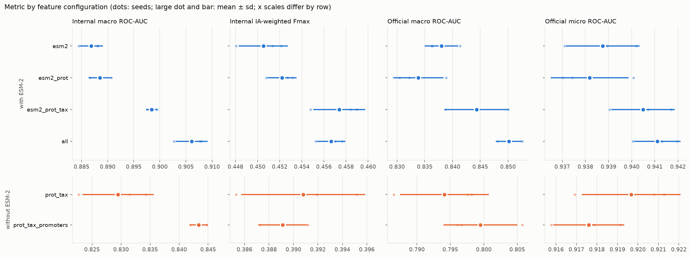
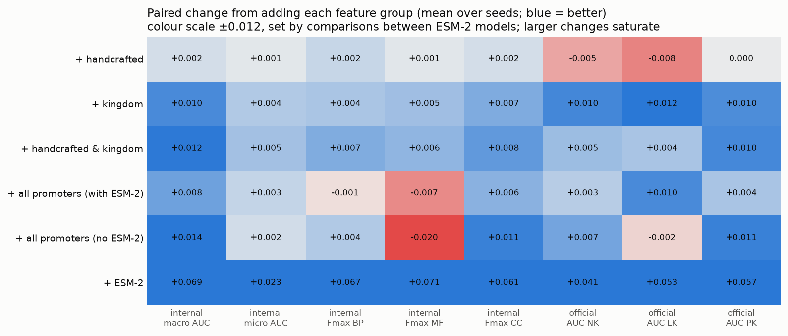
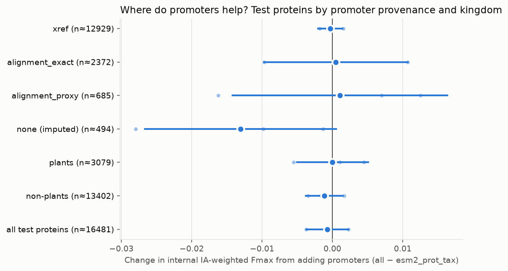

# Which feature groups help CAFA6 GO-term prediction?

**ESM-2 does nearly all the work. Kingdom features add a small, consistent gain; handcrafted
sequence features do not.** It adds about 0.07 internal macro ROC-AUC and 0.05 official macro
ROC-AUC over handcrafted and kingdom features alone.

**Promoter DNA embeddings improve per-term ranking (macro ROC-AUC) on every seed**, both on held-out
proteins and on the official CAFA6 ground truth, but they do not move IA-weighted Fmax.

**As hypothesised, the promoter gain is largest for "response to …" processes.** Without ESM-2
they gain twice as much as other process terms (p = 0.0001). With ESM-2 the extra benefit is weak,
and it depends on how response terms are defined. Promoters carry real expression-linked signal,
but the protein language model already captures most of it.

## Setup

- **Model:** the multi-label neural network ([docs/modeling.md](../docs/modeling.md)):
  - outputs the 1,000 most frequent GO terms plus all their ancestors (2,180 outputs);
  - one projection per feature group;
  - score channels (taxon prior, ESM-2 nearest neighbours) are **off**, so only the input
    features differ between configs.
- **Configs:** six, each a set of feature groups ([docs/features.md](../docs/features.md)):

  | Config | Feature groups |
  |---|---|
  | `esm2` | ESM-2 150M embedding (640-d) |
  | `esm2_prot` | + 56 handcrafted sequence features |
  | `esm2_prot_tax` | + 7-way kingdom one-hot |
  | `all` | + promoter embeddings: Nucleotide Transformer v2 (all species) and AgroNT (plants) |
  | `prot_tax` | handcrafted + kingdom, no ESM-2 |
  | `prot_tax_promoters` | handcrafted + kingdom + promoters, no ESM-2 |

- **Seeds:** 0, 1 and 2. A seed fixes the train/validation/test split and the initialisation.
  Every config sees the same split for a given seed, so all comparisons below are **paired**.
- **Internal evaluation:** a random 20% of the 82,404 labelled proteins is held out (16,481
  proteins). Early stopping uses a further validation split.
- **Official evaluation:** each model predicts the 8,023 proteins of the
  [CAFA6 final release](https://doi.org/10.6084/m9.figshare.32861969) under three settings:
  - no knowledge (NK);
  - limited knowledge (LK);
  - partial knowledge (PK), where annotations already known are excluded.

  ROC-AUC against this truth is computed for every run. The official CAFA evaluator, which takes
  about 20 minutes per run, was run for the best config; see [below](#official-cafa-scores).
- **Code:** git `2c147c8`. Reproduce with `uv run cafa6-ablation run --sweep feature-groups`, then
  `uv run cafa6-ablation report --sweep feature-groups`.

### Metrics

| Metric | Where | Meaning |
|---|---|---|
| Macro ROC-AUC | internal, official | mean per-term AUC over terms with both positives and negatives; every term counts equally |
| Micro ROC-AUC | internal, official | one AUC over all pooled protein–term pairs; dominated by common terms |
| IA-weighted Fmax | internal | protein-centric CAFA Fmax weighted by information accretion, mean of BP/MF/CC |
| f_w, f_micro_w, s_w | official | CAFA evaluator weighted Fmax, weighted micro-F, weighted S-min (lower is better), mean over aspects then NK/LK/PK |

## Results

Mean ± sd over 3 seeds. Official values are means over NK, LK and PK.

| Config               | Feature groups                            | Internal macro AUC   | Internal micro AUC   | Internal Fmax   | Official macro AUC   | Official micro AUC   | Parameters   |
|:---------------------|:------------------------------------------|:---------------------|:---------------------|:----------------|:---------------------|:---------------------|:-------------|
| `esm2`               | ESM-2                                     | 0.887 ± 0.002        | 0.945 ± 0.001        | 0.451 ± 0.002   | 0.838 ± 0.003        | 0.939 ± 0.002        | 0.99M        |
| `esm2_prot`          | ESM-2 + handcrafted                       | 0.889 ± 0.002        | 0.946 ± 0.000        | 0.452 ± 0.001   | 0.834 ± 0.004        | 0.938 ± 0.002        | 1.01M        |
| `esm2_prot_tax`      | ESM-2 + handcrafted + kingdom             | 0.898 ± 0.001        | 0.950 ± 0.000        | 0.457 ± 0.002   | 0.844 ± 0.006        | 0.940 ± 0.001        | 1.01M        |
| `all`                | ESM-2 + handcrafted + kingdom + promoters | 0.906 ± 0.003        | 0.952 ± 0.001        | 0.457 ± 0.001   | 0.850 ± 0.002        | 0.941 ± 0.001        | 1.37M        |
| `prot_tax`           | handcrafted + kingdom                     | 0.829 ± 0.006        | 0.927 ± 0.002        | 0.391 ± 0.005   | 0.794 ± 0.007        | 0.920 ± 0.002        | 0.71M        |
| `prot_tax_promoters` | handcrafted + kingdom + promoters         | 0.843 ± 0.001        | 0.928 ± 0.000        | 0.389 ± 0.002   | 0.799 ± 0.005        | 0.918 ± 0.002        | 1.07M        |

Official macro ROC-AUC by knowledge setting:

| Config               | NK macro AUC   | LK macro AUC   | PK macro AUC   |
|:---------------------|:---------------|:---------------|:---------------|
| `esm2`               | 0.841 ± 0.005  | 0.851 ± 0.007  | 0.822 ± 0.006  |
| `esm2_prot`          | 0.836 ± 0.004  | 0.843 ± 0.010  | 0.823 ± 0.006  |
| `esm2_prot_tax`      | 0.846 ± 0.006  | 0.855 ± 0.008  | 0.832 ± 0.003  |
| `all`                | 0.849 ± 0.003  | 0.865 ± 0.004  | 0.837 ± 0.004  |
| `prot_tax`           | 0.805 ± 0.011  | 0.802 ± 0.003  | 0.775 ± 0.007  |
| `prot_tax_promoters` | 0.812 ± 0.007  | 0.800 ± 0.008  | 0.786 ± 0.004  |

### Paired effect of each feature group

Each cell is the change from adding a group: mean ± sd over seeds, then (seeds improved / seeds).
An effect is called **consistent** when every seed agrees on the sign and |mean| > sd; anything
else is **inconclusive**.

| Comparison                   | Configs                           | Internal macro AUC     | Internal Fmax          | Official macro AUC     | Official micro AUC     |
|:-----------------------------|:----------------------------------|:-----------------------|:-----------------------|:-----------------------|:-----------------------|
| + handcrafted                | `esm2_prot` − `esm2`              | +0.0017 ± 0.0013 (3/3) | +0.0017 ± 0.0009 (3/3) | -0.0041 ± 0.0016 (0/3) | -0.0006 ± 0.0008 (0/3) |
| + kingdom                    | `esm2_prot_tax` − `esm2_prot`     | +0.0099 ± 0.0027 (3/3) | +0.0052 ± 0.0032 (3/3) | +0.0105 ± 0.0037 (3/3) | +0.0023 ± 0.0012 (3/3) |
| + handcrafted & kingdom      | `esm2_prot_tax` − `esm2`          | +0.0116 ± 0.0030 (3/3) | +0.0069 ± 0.0039 (3/3) | +0.0064 ± 0.0035 (3/3) | +0.0017 ± 0.0018 (3/3) |
| + all promoters (with ESM-2) | `all` − `esm2_prot_tax`           | +0.0077 ± 0.0023 (3/3) | -0.0007 ± 0.0030 (1/3) | +0.0058 ± 0.0046 (3/3) | +0.0006 ± 0.0020 (1/3) |
| + all promoters (no ESM-2)   | `prot_tax_promoters` − `prot_tax` | +0.0139 ± 0.0051 (3/3) | -0.0017 ± 0.0032 (1/3) | +0.0054 ± 0.0055 (2/3) | -0.0021 ± 0.0009 (0/3) |
| + ESM-2                      | `esm2_prot_tax` − `prot_tax`      | +0.0689 ± 0.0057 (3/3) | +0.0666 ± 0.0028 (3/3) | +0.0503 ± 0.0088 (3/3) | +0.0208 ± 0.0030 (3/3) |

- **ESM-2 is the foundation.** It is consistent on every metric and an order of magnitude larger
  than any other effect.
- **Kingdom helps consistently**, on internal and official metrics alike. The cheapest feature
  group is the second most useful.
- **Handcrafted features don't transfer.** They give a small consistent internal gain but a
  consistent *loss* on the official truth (−0.004 macro AUC, 0/3 seeds improved). Much of what
  they encode (hydrophobicity, charge, disorder) is predictable from ESM-2 embeddings (see
  `notebooks/embedding_vs_manual_features.ipynb`). The extra inputs seem to fit the random internal
  split rather than the newer proteins in the CAFA6 release.

## Do promoters help?

**Yes, for per-term ranking, but not for protein-level CAFA Fmax.**

- **With ESM-2,** adding promoter embeddings consistently raises macro ROC-AUC:
  - internal: +0.0077 ± 0.0023, 3/3 seeds;
  - official: +0.0058 ± 0.0046, 3/3 seeds, with the biggest gain in the limited-knowledge
    setting.

  Internal Fmax and micro AUC are unchanged (inconclusive).
- **Without ESM-2,** the internal macro gain is larger (+0.0139), so promoters carry real signal
  of their own. Part of it overlaps with what ESM-2 provides.
- **Reading:** macro AUC weights every term equally, while micro AUC and Fmax are dominated by
  common, high-information-content annotations. So promoters help rank the long tail of
  specific terms, and the protein-level metrics barely register it.
- **Promoter source doesn't explain much.** Splitting test proteins by how their promoter was
  obtained or by kingdom, the Fmax change is within noise for every group. The exception is
  proteins with no promoter at all, whose imputed vector slightly hurts on average (−0.013,
  inconclusive). The plant-only AgroNT model brings no visible extra gain for plants.

| Test proteins     |   Proteins | Δ Fmax (with − without promoters)   |
|:------------------|-----------:|:------------------------------------|
| xref              |      12929 | -0.0003 ± 0.0017 (1/3)              |
| alignment_exact   |       2372 | +0.0005 ± 0.0102 (2/3)              |
| alignment_proxy   |        685 | +0.0011 ± 0.0153 (2/3)              |
| none (imputed)    |        494 | -0.0130 ± 0.0136 (0/3)              |
| plants            |       3079 | +0.0000 ± 0.0051 (2/3)              |
| non-plants        |      13402 | -0.0011 ± 0.0026 (1/3)              |
| all test proteins |      16481 | -0.0007 ± 0.0030 (1/3)              |

The groups in the first four rows are:
- **xref:** promoter from the protein's own gene (Ensembl cross-reference);
- **alignment_exact:** same-species gene found by DIAMOND;
- **alignment_proxy:** related-species gene;
- **none (imputed):** no promoter, imputed from ESM-2 neighbours.

### Are promoters most useful for "response to" terms?

**Hypothesis.** Promoters encode transcriptional regulation, so they should help most for
processes defined by *inducible expression*: "response to heat", "response to glucose", and so
on.

**Test.**
- For each biological-process term, take the change in held-out ROC-AUC from adding promoters,
  averaged over seeds.
- Compare response terms against all other process terms, with response terms defined two ways:
  - **by name:** "response to …" or "cellular response to …";
  - **by ontology:** any descendant of *response to stimulus*, GO:0050896. This set is broader,
    for example "protein refolding".
- Rare terms have noisier AUCs, so the primary p-value comes from a permutation test that
  shuffles the response label only among terms of similar test-set frequency (quintiles). The
  Mann-Whitney test is secondary.

| Adding                  | Definition                 | Response terms   | Other process terms   | Improved (response / other)   |   p, prevalence-stratified |   p, Mann-Whitney | Seeds where response > other   |
|:------------------------|:---------------------------|:-----------------|:----------------------|:------------------------------|---------------------------:|------------------:|:-------------------------------|
| promoters with ESM-2    | name: 'response to …'      | +0.0115 (n=164)  | +0.0085 (n=1299)      | 74% / 72%                     |                     0.0193 |           0.013   | 2/3                            |
| promoters with ESM-2    | ontology: under GO:0050896 | +0.0095 (n=253)  | +0.0088 (n=1210)      | 74% / 72%                     |                     0.5272 |           0.15    | 2/3                            |
| promoters without ESM-2 | name: 'response to …'      | +0.0313 (n=164)  | +0.0153 (n=1299)      | 88% / 69%                     |                     0.0001 |           0       | 3/3                            |
| promoters without ESM-2 | ontology: under GO:0050896 | +0.0243 (n=253)  | +0.0156 (n=1210)      | 77% / 70%                     |                     0.0006 |           0.00044 | 3/3                            |

- **Without ESM-2 the hypothesis holds clearly.** Promoters raise response-term AUC twice as much
  as other process terms (+0.031 vs +0.015), and 88% of response terms improve, against 69% of
  others. The result holds under both definitions, on every seed, and after controlling for term
  frequency.
- **With ESM-2 the extra benefit mostly disappears.** It is significant only for the narrower
  name-based set (p = 0.019, 2/3 seeds) and absent for the broader ontology set (p = 0.53).
  Promoter DNA carries real stimulus-response information, but much of it is redundant with
  protein sequence. Plausibly that's because inducible protein families (heat-shock proteins,
  hormone-response factors) are themselves recognisable from sequence.
- **The most-helped terms are textbook inducible expression programmes:** responses to leukemia
  inhibitory factor, ischemia, glucose and glucose starvation, corticosteroids and cAMP.

Most-helped "response to" terms when promoters are added to the ESM-2 model (at least 20 positive
test proteins):

| GO term    | Name                                            |   Test positives |   Δ AUC |
|:-----------|:------------------------------------------------|-----------------:|--------:|
| GO:1990823 | response to leukemia inhibitory factor          |               26 |   0.105 |
| GO:1990830 | cellular response to leukemia inhibitory factor |               25 |   0.103 |
| GO:0002931 | response to ischemia                            |               20 |   0.068 |
| GO:0042149 | cellular response to glucose starvation         |               22 |   0.066 |
| GO:0071333 | cellular response to glucose stimulus           |               36 |   0.048 |
| GO:0071331 | cellular response to hexose stimulus            |               37 |   0.046 |
| GO:0031960 | response to corticosteroid                      |               63 |   0.045 |
| GO:0009749 | response to glucose                             |               72 |   0.045 |

…and to the model without ESM-2:

| GO term    | Name                                            |   Test positives |   Δ AUC |
|:-----------|:------------------------------------------------|-----------------:|--------:|
| GO:0002931 | response to ischemia                            |               20 |   0.17  |
| GO:1990830 | cellular response to leukemia inhibitory factor |               25 |   0.161 |
| GO:1990823 | response to leukemia inhibitory factor          |               26 |   0.16  |
| GO:0014823 | response to activity                            |               34 |   0.112 |
| GO:0048678 | response to axon injury                         |               26 |   0.103 |
| GO:0042149 | cellular response to glucose starvation         |               22 |   0.096 |
| GO:0051591 | response to cAMP                                |               33 |   0.092 |
| GO:0071322 | cellular response to carbohydrate stimulus      |               49 |   0.086 |

Every term's effect is in [`summary/response_term_deltas.csv`](summary/response_term_deltas.csv).

## Internal vs official evaluation

**The two agree on the big picture** (ESM-2 ≫ kingdom > promoters) **but disagree on handcrafted
features.** Those help internally and hurt officially. The internal split is random by protein,
so close homologues often land on both sides of it. The CAFA6 targets were annotated after
training, so they reward features that generalise.

**Official CAFA evaluator scores.** These cover the best config by internal macro ROC-AUC
(`all`), which was chosen on the internal holdout, not on these scores. The `esm2` baseline is
included as a reference:

<!-- cafaeval-table -->
| Config   |   Seeds |   f_w NK |   f_w LK |   f_w PK |   f_w overall |   f_micro_w NK |   f_micro_w LK |   f_micro_w PK |   f_micro_w overall |   s_w (lower better) overall |
|:---------|--------:|---------:|---------:|---------:|--------------:|---------------:|---------------:|---------------:|--------------------:|-----------------------------:|
| `esm2`   |       0 |    0.393 |    0.398 |    0.162 |         0.318 |          0.308 |          0.343 |           0.11 |               0.254 |                       10.825 |
<!-- /cafaeval-table -->

Every run's predictions are kept, so the remaining configs can be scored later with
`uv run cafa6-ablation cafaeval --sweep feature-groups`.

## Caveats

- **Capacity:** promoter configs have about 0.36M more parameters (1.37M vs 1.01M). Part of the
  promoter gain could come from extra capacity rather than information. A follow-up architecture
  search (in progress) varies promoter widths and model depth directly.
- **Internal split:** random by protein, so homologues leak across it. That inflates absolute
  internal scores. Paired deltas are less affected, but the handcrafted-feature result shows
  internal deltas can still mislead.
- **Official truth:** one release, and only 8,023 proteins across NK/LK/PK, so many terms have
  few positives and official per-term AUCs are noisy.
- **Score channels off:** production models blend in a taxon prior and ESM-2 nearest-neighbour
  transfer. These may absorb part of the kingdom and promoter gains.
- **Three seeds:** enough to separate consistent effects from noise at this scale, but not for
  formal significance claims about config-level differences. The response-term tests are per
  GO term, with hundreds of terms per group.

## Per-configuration details

Each directory holds:
- `config.json`: feature groups, trainer flags, seeds, git revision;
- `metrics.csv`: every internal and official metric per seed;
- `per_term_auc.csv`: held-out ROC-AUC and average precision per GO term, mean over seeds;
- `training_curves.png`: validation loss and Fmax by epoch;
- `pr_curves.png`: IA-weighted precision–recall per aspect.

[`esm2`](esm2/) · [`esm2_prot`](esm2_prot/) · [`esm2_prot_tax`](esm2_prot_tax/) · [`all`](all/) ·
[`prot_tax`](prot_tax/) · [`prot_tax_promoters`](prot_tax_promoters/)

Cross-run tables are in [`summary/`](summary/): `runs.csv`, `summary.csv`, `deltas.csv`,
`promoter_strata.csv`, `response_terms.csv`, `response_term_deltas.csv` and `cafaeval.csv`.
