# What does the final model rely on?

SHAP explanations of the best model: the wider architecture on ESM-2 + handcrafted + kingdom
features, without promoters, all 3 seeds.


**ESM-2 carries about 90% of the attribution for almost every GO term.** No small set of
embedding dimensions dominates. The model reads ESM-2 as a distributed representation, and most of
its important dimensions don't correspond to any handcrafted feature.

**The handcrafted features it does use make biological sense.** Kinase activity is driven by the
PROSITE kinase motifs, nucleus by the nuclear localisation signal, and plasma membrane by
transmembrane-helix count.

**Kingdom acts as a switch.** Only 7 one-hot features, but shuffling them drops plant-development
terms by about 0.35 AUC each.

**SHAP's term-specific dimensions find biology the handcrafted features miss.** A single
dimension that SHAP flags for transcription factor activity separates TFs with AUC 0.84, against
0.56 for intrinsic disorder. Three such dimensions are shared between DNA binding and TF activity,
a reused "DNA-binding protein" axis in ESM-2 ([details](#linking-known-biology-to-the-dimensions-shap-highlights)).

**GO terms the model predicts with the same ESM-2 dimensions form biologically coherent groups**
(the map above). In particular, **"response to" terms share an attribution profile**: 75% of each
response term's nearest neighbours are also response terms, against 11% by chance (p = 0.001).

## Method

- **Model:** `data/final/winner_esm2_prot_tax/seed{0,1,2}`, explained on each seed's held-out 20%
  test split. Inputs: 640 ESM-2 dimensions, 56 handcrafted features, 7 kingdom indicators.
- **SHAP:** `shap.GradientExplainer` (expected gradients) on one GO term's logit at a time, against
  a background of 256 training proteins.
  - In real data the SHAP sums track the logit differences closely (r = 0.99, median ratio
    1.00).
  - **Global pass:** all 2,180 output terms, up to 100 test positives each, 50 samples. Each
    term's attribution is summarised as the mean share of |SHAP| per feature group, and as mean
    |SHAP| per feature. Everything is averaged over seeds; seed-to-seed sd is in the CSVs.
  - **Deep dives:** 13 chosen terms, up to 500 positives + 500 negatives, 200 samples, handcrafted
    features only.
- **Group permutation importance:** each group is shuffled across test proteins (3 repeats), and
  the per-term drop in held-out ROC-AUC is recorded, on ontology-propagated scores as in
  training.
- **ESM-2 dimensions:**
  - per-dimension importance is each dimension's share of a term's ESM-2 attribution, averaged
    over terms;
  - Spearman correlation against the handcrafted features on 20,000 training proteins.
- **Maps:** UMAP of the test proteins' ESM-2 embeddings, and UMAP of GO terms by their ESM-2
  attribution profiles. Labelled clusters: k-means on the map, named after a representative
  specific term. Drawn with `datamapplot`.
- **Reproduce:**
  ```bash
  uv run cafa6-explain --model-dirs data/final/winner_esm2_prot_tax/seed{0,1,2}/model
  ```
  About 50 minutes on CPU. Per-seed SHAP is cached in `data/explainability/`.

## Which feature groups drive each GO term?

Mean share of |SHAP| per group ([`term_group_attribution.csv`](term_group_attribution.csv)):

| Terms                   |    n | ESM-2   | handcrafted   | kingdom   |
|:------------------------|-----:|:--------|:--------------|:----------|
| All terms               | 2180 | 90.2%   | 4.5%          | 5.3%      |
| Biological process      | 1463 | 89.9%   | 4.5%          | 5.6%      |
| Molecular function      |  303 | 93.5%   | 3.8%          | 2.7%      |
| Cellular component      |  414 | 89.2%   | 4.6%          | 6.1%      |
| "response to" processes |  164 | 89.0%   | 4.7%          | 6.3%      |
| other processes         | 1299 | 90.0%   | 4.5%          | 5.5%      |
| general (common) terms  |  727 | 91.3%   | 4.3%          | 4.4%      |
| intermediate terms      |  726 | 89.8%   | 4.6%          | 5.7%      |
| specific (rare) terms   |  727 | 89.7%   | 4.5%          | 5.8%      |

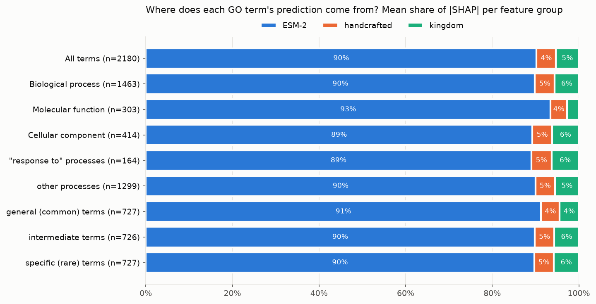

**ESM-2 dominates** everywhere, most of all for molecular functions, which are largely set by
sequence and domains.

**Per feature, the ranking reverses:**
- each kingdom indicator carries about **5×** the attribution of an average ESM-2 dimension;
- each handcrafted feature about **0.6×**.

**Response terms have the same group shares as other processes.** What sets them apart is
*which* ESM-2 dimensions they use (see the [map](#maps)).

**Permutation importance** gives the same ordering in AUC units. Median per-term drop in held-out
ROC-AUC ([`permutation_importance.csv`](permutation_importance.csv)):

|                    |   shuffle ESM-2 |   shuffle handcrafted |   shuffle kingdom |
|:-------------------|----------------:|----------------------:|------------------:|
| Biological process |          0.2858 |                0.0034 |            0.0619 |
| Molecular function |          0.4036 |                0.0023 |            0.0098 |
| Cellular component |          0.3345 |                0.0024 |            0.0483 |
| All terms          |          0.3166 |                0.0029 |            0.0467 |

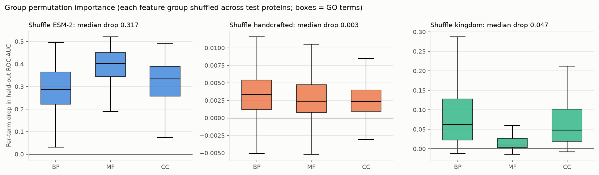

**Kingdom matters far more than its SHAP share suggests.** Shuffling it costs more than shuffling
all 56 handcrafted features for 95% of terms. The model uses it as a switch for kingdom-specific
biology: the most affected terms are all plant reproduction and development.

| GO term    | Name                                       |   AUC drop when kingdom shuffled |   AUC |
|:-----------|:-------------------------------------------|---------------------------------:|------:|
| GO:0009860 | pollen tube growth                         |                            0.359 | 0.964 |
| GO:0009845 | seed germination                           |                            0.356 | 0.943 |
| GO:0009553 | embryo sac development                     |                            0.349 | 0.934 |
| GO:0090351 | seedling development                       |                            0.342 | 0.938 |
| GO:0009932 | cell tip growth                            |                            0.34  | 0.964 |
| GO:0048229 | gametophyte development                    |                            0.331 | 0.939 |
| GO:0009555 | pollen development                         |                            0.33  | 0.944 |
| GO:0009793 | embryo development ending in seed dormancy |                            0.325 | 0.942 |

## Deep dives: did the model learn real biology?

Thirteen terms: stress responses, DNA-binding, disease-linked processes, and four sanity checks
with a known expected feature.

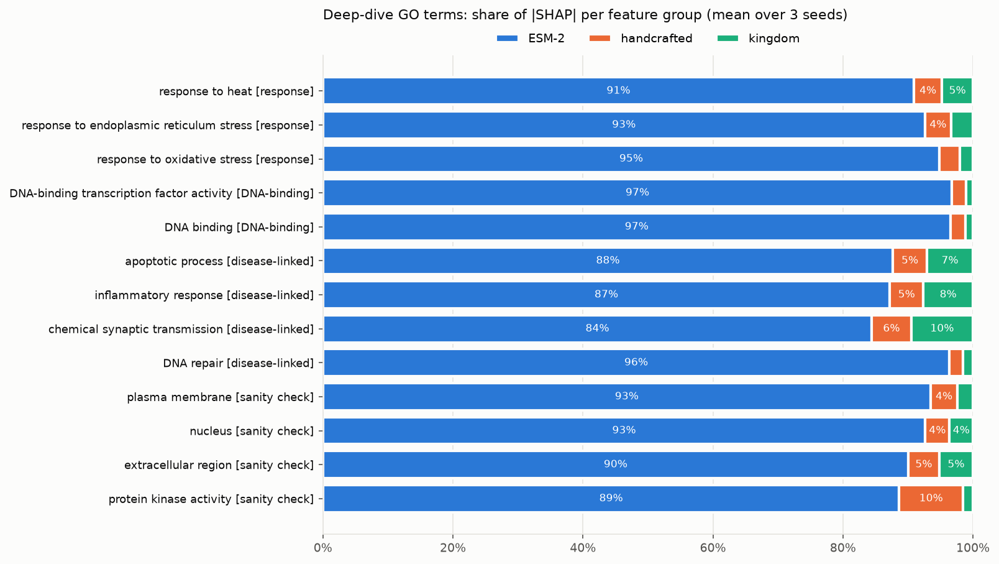

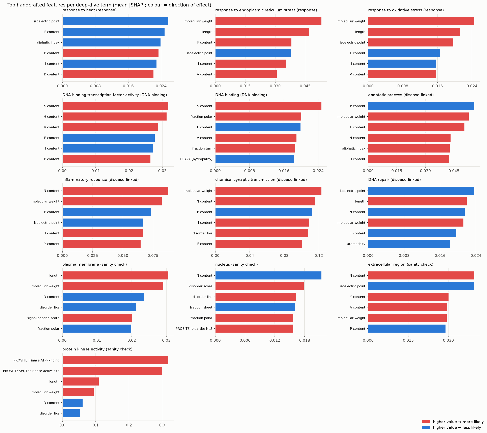

**Sanity checks.** Each expected feature's rank among the 56 handcrafted features. Direction is
the Spearman correlation between feature value and SHAP value, so positive means a higher value
raises the prediction.

| GO term                 | Expected feature                      |   Rank of 56 |   Direction |
|:------------------------|:--------------------------------------|-------------:|------------:|
| protein kinase activity | PROSITE kinase ATP-binding motif      |            1 |        0.79 |
| protein kinase activity | PROSITE Ser/Thr kinase active site    |            2 |        0.77 |
| nucleus                 | bipartite nuclear localisation signal |            6 |        0.27 |
| plasma membrane         | transmembrane helix count             |            8 |        0.76 |
| extracellular region    | signal peptide score                  |           15 |        0.41 |

- **Kinase activity is the clearest case** (below). Either PROSITE kinase motif shifts the logit
  by +1 to +2, the largest handcrafted effect among the deep-dive terms.
- **Nucleus and plasma membrane pick up their expected features**, in the right direction, among
  the top 10.
- **The signal peptide matters less than expected for extracellular proteins** (rank 15). ESM-2
  already captures secretion signals well, so the handcrafted score adds little on top.

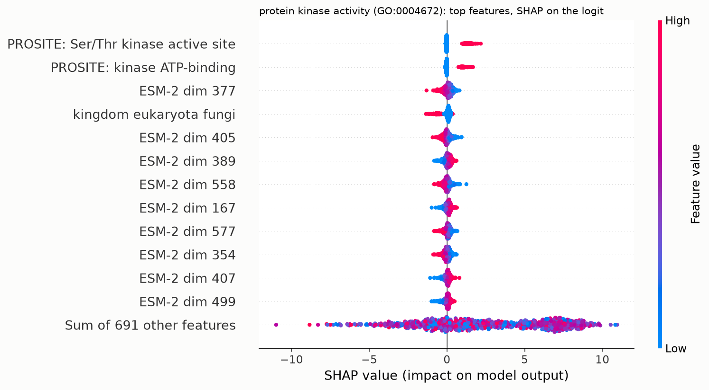

**Beeswarm plots for every deep-dive term** are in [`deep_dives/`](deep_dives/). They cover:
- heat, ER and oxidative stress responses;
- DNA binding and transcription factor activity;
- apoptosis, inflammation, synaptic transmission and DNA repair;
- the four sanity checks.

Each beeswarm ranks the top **individual** features of every kind together: ESM-2 dimensions
alongside handcrafted features. So you can see which specific embedding dimensions drive a term,
and where the handcrafted signals rank against them.

Across the 13 terms, the top 12 individual features are:
- **mostly ESM-2 dimensions:** 5–12 per term, and all 12 for DNA binding and transcription factor
  activity;
- **then kingdom indicators:** up to 5 for apoptosis and inflammation;
- **rarely handcrafted features:** the kinase motifs (ranked #1 and #2 for kinase activity), plus
  one or two for synaptic transmission and inflammation.

The signature dimensions from the linking analysis appear here too: dim 377 is #3 for kinase
activity, and dim 399 is in the top 12 for transcription factor activity.

**Outside the sanity checks, the handcrafted signal is mostly composition and size:**
- stress responses lean on isoelectric point, length and residue content;
- DNA-binding terms lean on serine and histidine content, which are enriched in many
  transcription-factor families;
- disease-linked processes lean on size and composition.

These effects are small next to ESM-2 (each feature ≤ 0.12 mean |SHAP|), consistent with the
ablation, where handcrafted features did not improve official scores.

## ESM-2 dimensions, one by one

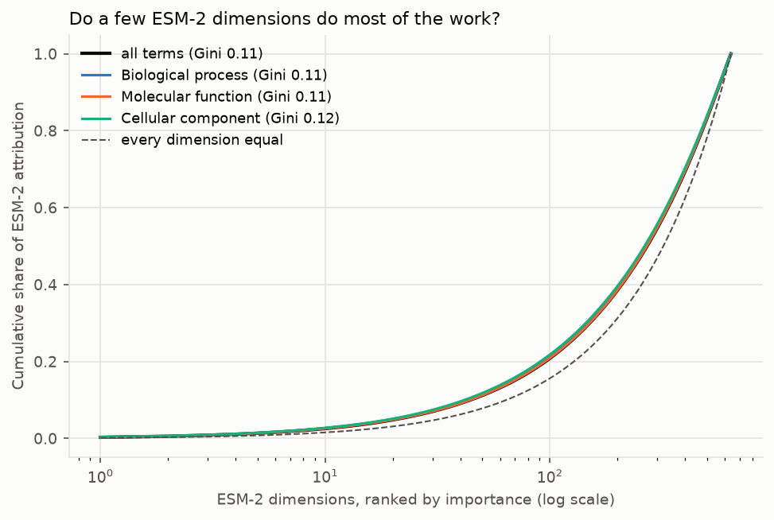

**No dimension is special.**
- The importance curve sits just above uniform (Gini 0.11).
- The top 10 of 640 dimensions carry 2.6% of the attribution, and the top 64 carry 14%.
- The most important dimension is only 1.9× its uniform share.
- Dimension rankings agree only moderately across the three trained seeds (Spearman ρ ≈ 0.67).

So the network reads ESM-2 holistically rather than relying on a few interpretable directions.
([`esm2_dimension_importance.csv`](esm2_dimension_importance.csv))

| Dimension   | Share of ESM-2 attribution   |   × uniform | Strongest handcrafted correlate   |   Spearman ρ |
|:------------|:-----------------------------|------------:|:----------------------------------|-------------:|
| dim 12      | 0.30%                        |         1.9 | aa_fraction_I                     |         0.3  |
| dim 168     | 0.28%                        |         1.8 | aa_fraction_A                     |         0.35 |
| dim 405     | 0.27%                        |         1.7 | fraction_turn                     |         0.28 |
| dim 129     | 0.26%                        |         1.7 | aa_fraction_D                     |        -0.37 |
| dim 253     | 0.26%                        |         1.6 | aa_fraction_A                     |        -0.35 |
| dim 500     | 0.25%                        |         1.6 | aromaticity                       |         0.28 |
| dim 354     | 0.24%                        |         1.6 | aa_fraction_A                     |        -0.21 |
| dim 380     | 0.24%                        |         1.5 | aa_fraction_F                     |        -0.32 |

**What do the important dimensions encode?** Only weakly anything the handcrafted features
measure.
- Across the top 40 dimensions, the median strongest correlation with any handcrafted feature is
  |ρ| = 0.32, and the maximum is 0.60 (β-sheet fraction).
- 38% have no handcrafted correlate above 0.3.
- The handcrafted features capture a small, mostly compositional slice of what ESM-2 encodes,
  which is why adding them changes little.

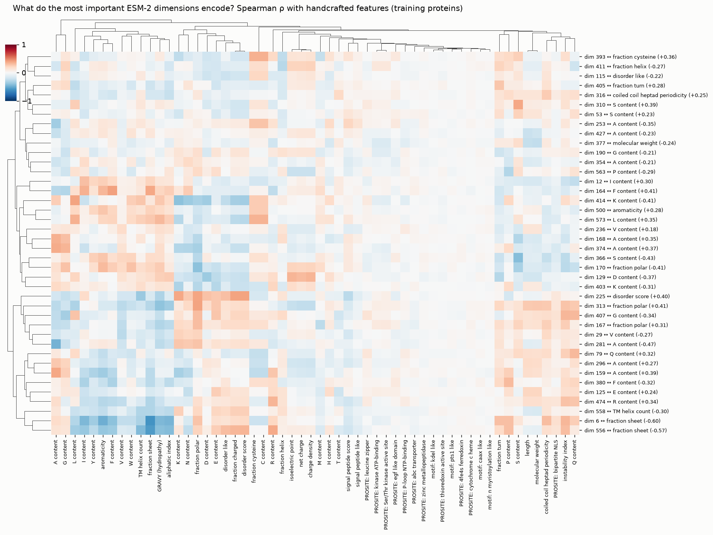


## Linking known biology to the dimensions SHAP highlights

For each GO term with a well-known sequence signal, **which ESM-2 dimensions does the model rely
on for that term, and do they encode the known signal or something else?**

- **Signature dimensions:** the dimensions with the highest *lift* among the term's 30
  highest-attribution dimensions. Lift is the term's attribution share for a dimension divided by
  that dimension's average share across all terms, so it picks dimensions used specifically for
  this term rather than ones that matter for everything.
- **Each signature dimension is compared with the known feature** on two measures:
  - how well each one alone separates annotated from unannotated test proteins (AUC);
  - how strongly they correlate with each other (Spearman ρ).

**In the figure:**
- **Rows:** GO annotation | known sequence biology | the signature dimension | the dimension's
  value distribution for annotated vs other proteins.
- **The black outline** marks where the annotated proteins sit on the map.

([`term_signature_dimensions.csv`](term_signature_dimensions.csv) has the top 5 per term.)

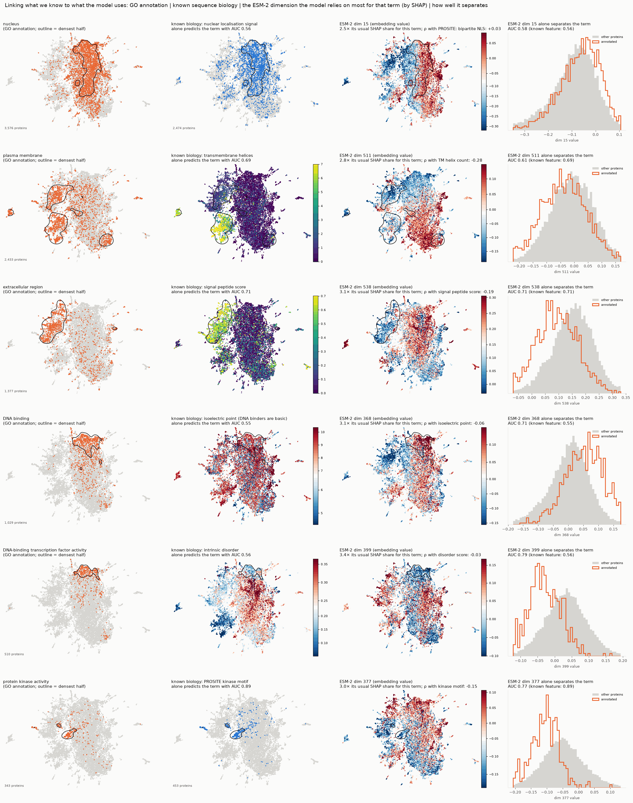

| GO term                                   | Known biology                             | Dimension   | Lift   |   AUC alone (dimension) |   AUC alone (known feature) |   ρ with known feature | Strongest handcrafted correlate   |
|:------------------------------------------|:------------------------------------------|:------------|:-------|------------------------:|----------------------------:|-----------------------:|:----------------------------------|
| nucleus                                   | nuclear localisation signal               | dim 15      | 2.5×   |                    0.58 |                        0.56 |                   0.03 | aa_fraction_L (-0.35)             |
| nucleus                                   | nuclear localisation signal               | dim 0       | 2.4×   |                    0.54 |                        0.56 |                   0.01 | aa_fraction_L (-0.29)             |
| plasma membrane                           | transmembrane helices                     | dim 511     | 2.8×   |                    0.61 |                        0.69 |                  -0.28 | aa_fraction_S (-0.29)             |
| plasma membrane                           | transmembrane helices                     | dim 531     | 2.5×   |                    0.63 |                        0.69 |                   0.27 | aa_fraction_R (-0.28)             |
| extracellular region                      | signal peptide score                      | dim 538     | 3.1×   |                    0.71 |                        0.71 |                  -0.19 | aa_fraction_G (-0.46)             |
| extracellular region                      | signal peptide score                      | dim 328     | 2.8×   |                    0.69 |                        0.71 |                   0.25 | signal_peptide_score (+0.25)      |
| DNA binding                               | isoelectric point (DNA binders are basic) | dim 368     | 3.1×   |                    0.71 |                        0.55 |                  -0.06 | aa_fraction_N (+0.34)             |
| DNA binding                               | isoelectric point (DNA binders are basic) | dim 542     | 2.8×   |                    0.68 |                        0.55 |                   0.04 | aa_fraction_A (+0.39)             |
| DNA-binding transcription factor activity | intrinsic disorder                        | dim 399     | 3.4×   |                    0.79 |                        0.56 |                  -0.03 | aa_fraction_Q (-0.26)             |
| DNA-binding transcription factor activity | intrinsic disorder                        | dim 75      | 3.1×   |                    0.84 |                        0.56 |                  -0.07 | instability_index (-0.44)         |
| protein kinase activity                   | PROSITE kinase motif                      | dim 377     | 3.0×   |                    0.77 |                        0.89 |                  -0.15 | molecular_weight (-0.25)          |
| protein kinase activity                   | PROSITE kinase motif                      | dim 73      | 2.9×   |                    0.77 |                        0.89 |                   0.18 | aa_fraction_A (-0.34)             |

**What it shows:**
- **DNA binding and transcription factors: the model found a signal the handcrafted features miss.**
  - A single signature dimension separates transcription factors with AUC 0.79–0.84, and DNA
    binders with 0.71. The textbook sequence proxies, intrinsic disorder and a basic isoelectric
    point, manage only 0.55–0.56.
  - These dimensions are essentially uncorrelated with those proxies (|ρ| ≤ 0.07).
  - **Dims 368, 399 and 333 are in the top five for both DNA binding and transcription factor
    activity.** SHAP points to a shared "DNA-binding protein" axis in ESM-2 that the model reuses
    across related terms. On the map, transcription factors sit where dim 399 is low and DNA
    binders where dim 368 is high.
- **Extracellular proteins:**
  - dim 538 alone separates them as well as the signal-peptide score (AUC 0.71 each);
  - dim 328 partly tracks the signal peptide itself (ρ = +0.25).

  The model has an embedding-level secretion signal alongside the explicit one.
- **Plasma membrane:** the signature dimensions partly track transmembrane helices (ρ ≈ ±0.28).
  Each is a weaker single cue than the helix count, so membrane identity is spread across several
  dimensions.
- **Kinases:** the PROSITE motif is still the strongest single cue (AUC 0.89, against 0.77 for the
  best dimension). The signature dimensions barely correlate with it (|ρ| ≤ 0.18), so the model
  recognises kinases from more than the motif.
- **Nucleus:** no single dimension separates nuclear proteins well (≤ 0.58 for the top
  signatures), and neither does the nuclear localisation signal (0.56). Nuclear localisation is
  encoded diffusely.

## Maps

**Proteins.** The same held-out proteins, coloured by GO annotations (orange) next to the sequence
features that should explain them (blue). Each feature panel states its enrichment, e.g.:
- 60% of kinase-motif proteins are annotated kinases, against 2% overall;
- 30% of signal-peptide proteins are extracellular, against 8%;
- 36% of proteins with a nuclear localisation signal are nuclear, against 22%.

Function, localisation and biophysics are all organised in the embedding before the network
sees it.

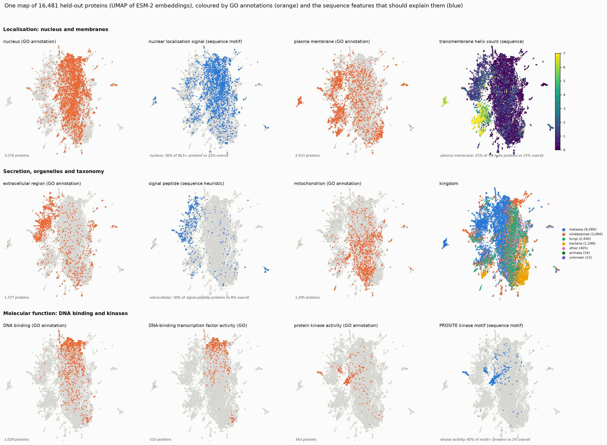

The same map coloured by the 8 most important ESM-2 dimensions overall. Each shows a smooth
regional pattern rather than noise, even though no single dimension matters much on its own:

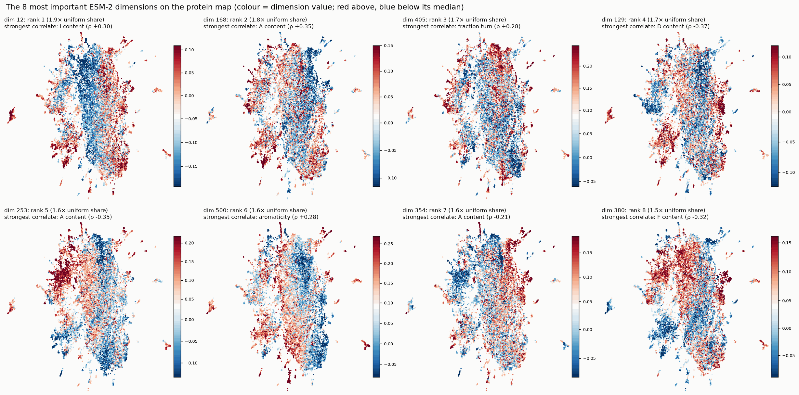

**GO terms.** Each term is placed by the ESM-2 dimensions the model uses to predict it, with no
GO structure used. Related functions still group together (ion transport, kinase activity, DNA
metabolism, vesicle transport, neuron generation, plasma membrane), as in the labelled map at the
top.

The plain version below marks the deep-dive terms:
- the **"response to" terms form one tight cluster**: 75% of each response term's 10 nearest
  neighbours are response terms, against an 11% base rate (permutation p = 0.001);
- **stress responses** (heat, oxidative stress) sit in that cluster.

The model predicts stimulus-response processes through a *shared* pattern of embedding
dimensions. That pattern is distinct from other processes, even though the feature-group shares
are the same.

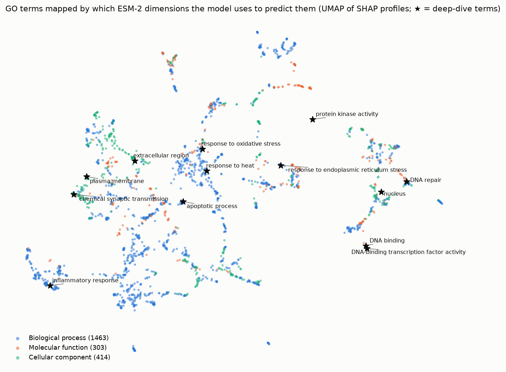

## Caveats

- **Individual ESM-2 dimensions are a basis choice, not semantic units.** A rotation of the
  embedding would carry the same information. Dimension-level results describe how this network
  reads this embedding.
- **Correlated features share credit.** ESM-2 already encodes much of the handcrafted signal, so
  SHAP splits credit between them, and permutation measures each group's *unique* contribution
  given the others. Shuffling also creates unrealistic feature combinations (most visibly for
  kingdom), which can exaggerate permutation drops.
- **Attributions are relative to the background.** That's 256 training proteins, and the
  attributions are for the pre-sigmoid logit of each term, before ontology propagation.
- **The global pass caps each term at 100 positives,** so rare terms are explained on all their
  positives and common terms on a sample. The seed-to-seed sd of group shares is small (median
  under 0.007).
- **Signature dimensions are chosen and evaluated on the same held-out proteins.** Selection uses
  SHAP magnitude, not how well a dimension separates the labels, but the single-dimension AUCs are
  still mildly optimistic. They're descriptive, not a held-out benchmark.

## Files

| File | Contents |
|---|---|
| `term_group_attribution.csv` | every GO term: share of \|SHAP\| for ESM-2 / handcrafted / kingdom, mean and sd over seeds |
| `permutation_importance.csv` | every GO term: baseline AUC and AUC drop when each group is shuffled |
| `term_top_features.csv` | every GO term: its 10 most important inputs |
| `deep_dive_features.csv` | deep-dive terms × every input feature (ESM-2 dimensions, handcrafted, kingdom): mean \|SHAP\|, mean SHAP, direction |
| `esm2_dimension_importance.csv` | each ESM-2 dimension: importance overall and per aspect, rank, seed sd |
| `esm2_dimension_feature_correlation.csv` | top 40 dimensions × handcrafted features, Spearman ρ |
| `term_signature_dimensions.csv` | 6 GO terms with known biology: top 5 term-specific dimensions, lift, single-dimension AUC, correlation with the known feature |
| `summary.json` | concentration statistics and seed agreement |
