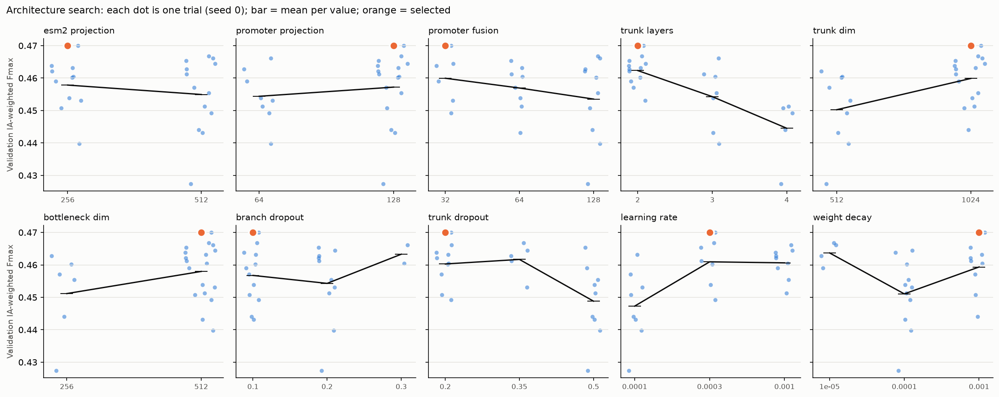

# Architecture search, and the final model

**A wider network beats the default architecture, and dropping promoters is still better.** The
best model on the official CAFA6 evaluation is the selected architecture *without* promoter
features:
- weighted Fmax 0.326, against 0.313 for the default architecture with promoters;
- significantly better than every other combination in the protein bootstrap.

## Search

- **Setup:** 24 random trials on the `all` feature set (ESM-2 + handcrafted + kingdom +
  promoters), seed 0, score channels off, as in the [feature ablation](../README.md). Trial 0
  is the default architecture.
- **Search space:**
  - trunk width 512 / 1024, bottleneck 256 / 512, trunk depth 2 / 3 / 4 layers;
  - ESM-2 branch 256 / 512, promoter branches 64 / 128, fused promoter vector 32 / 64 / 128;
  - branch dropout 0.1 / 0.2 / 0.3, trunk dropout 0.2 / 0.35 / 0.5;
  - learning rate 1e-4 / 3e-4 / 1e-3, weight decay 1e-5 / 1e-4 / 1e-3.
- **Selection:** on **validation** IA-weighted Fmax only. The test split and the official truth
  were used only to report the selected model.
- **Reproduce:**
  ```bash
  uv run cafa6-hparam-search run --sweep arch --features all --trials 24
  uv run cafa6-hparam-search finalize --sweep arch
  uv run cafa6-hparam-search report --sweep arch
  ```



The top 8 trials (seed 0, by validation Fmax) and the default (`trial00`, which ranked 12 of 24):

| Trial   |   Trunk |   Bottleneck |   Layers |   ESM-2 proj. |   Promoter proj. |   Promoter fusion |   Branch drop. |   Trunk drop. |     LR |     WD |   Val Fmax |   Test Fmax | Params   |
|:--------|--------:|-------------:|---------:|--------------:|-----------------:|------------------:|---------------:|--------------:|-------:|-------:|-----------:|------------:|:---------|
| trial10 |    1024 |          512 |        2 |           256 |              128 |                32 |            0.1 |          0.2  | 0.0003 | 0.001  |     0.47   |      0.4651 | 2.41M    |
| trial14 |    1024 |          512 |        2 |           512 |              128 |               128 |            0.1 |          0.35 | 0.0003 | 1e-05  |     0.4667 |      0.4632 | 2.96M    |
| trial12 |    1024 |          512 |        3 |           512 |               64 |               128 |            0.3 |          0.2  | 0.001  | 1e-05  |     0.4661 |      0.4623 | 3.86M    |
| trial20 |    1024 |          512 |        2 |           512 |              128 |                64 |            0.2 |          0.5  | 0.0003 | 0.001  |     0.4654 |      0.4634 | 2.88M    |
| trial09 |    1024 |          512 |        2 |           512 |              128 |                32 |            0.2 |          0.35 | 0.001  | 0.0001 |     0.4645 |      0.4612 | 2.84M    |
| trial11 |    1024 |          512 |        2 |           256 |              128 |                32 |            0.1 |          0.2  | 0.001  | 0.0001 |     0.4638 |      0.4607 | 2.41M    |
| trial23 |    1024 |          512 |        2 |           256 |              128 |                64 |            0.1 |          0.2  | 0.0001 | 0.001  |     0.4631 |      0.461  | 2.45M    |
| trial13 |    1024 |          256 |        2 |           512 |               64 |               128 |            0.2 |          0.35 | 0.001  | 1e-05  |     0.4628 |      0.4583 | 1.99M    |
| trial00 |     512 |          256 |        2 |           256 |              128 |               128 |            0.1 |          0.2  | 0.0003 | 0.0001 |     0.4602 |      0.457  | 1.37M    |

Mean validation Fmax for each value of each hyperparameter, sorted by how much it matters (random
search, so other settings vary underneath and these are marginal effects only):

| Hyperparameter      | Mean validation Fmax by value (n trials)                        |   Range of means |
|:--------------------|:----------------------------------------------------------------|-----------------:|
| trunk_layers        | 2: 0.4623 (12), 3: 0.4543 (7), 4: 0.4445 (5)                    |           0.0178 |
| learning_rate       | 0.0001: 0.4473 (8), 0.0003: 0.4609 (7), 0.001: 0.4606 (9)       |           0.0136 |
| trunk_dropout       | 0.2: 0.4603 (10), 0.35: 0.4617 (5), 0.5: 0.4488 (9)             |           0.0129 |
| weight_decay        | 1e-05: 0.4637 (4), 0.0001: 0.4511 (11), 0.001: 0.4594 (9)       |           0.0126 |
| trunk_dim           | 512: 0.4503 (9), 1024: 0.4599 (15)                              |           0.0096 |
| branch_dropout      | 0.1: 0.4568 (12), 0.2: 0.4543 (10), 0.3: 0.4633 (2)             |           0.009  |
| bottleneck_dim      | 256: 0.4512 (6), 512: 0.4580 (18)                               |           0.0068 |
| promoter_fusion     | 32: 0.4599 (6), 64: 0.4569 (8), 128: 0.4535 (10)                |           0.0064 |
| esm2_projection     | 256: 0.4578 (11), 512: 0.4549 (13)                              |           0.0029 |
| promoter_projection | 64: 0.4544 (8), 128: 0.4572 (16)                                |           0.0028 |

What the search shows:
- **Width helps, depth hurts.** All of the top 7 trials use a 1024-wide trunk with a 512
  bottleneck. Extra trunk layers are consistently worse.
- **Optimisation matters about as much as size.** A learning rate of 1e-4 is too slow for this
  budget, and trunk dropout of 0.5 over-regularises.
- **Less promoter input is fine.** Squeezing the promoter signal to 32 dimensions does no harm,
  and is in fact the best on average. That fits the ablation's finding that promoters add
  little for the CAFA metrics.

**Selected:** `trial10`, which is the default architecture with three changes:
- trunk 1024 and bottleneck 512 (from 512 and 256);
- promoter fusion 32 (from 128);
- weight decay 1e-3 (from 1e-4).

Retrained on seeds 1 and 2 and compared, seed by seed, with the default architecture on the same
features ([`selected_vs_default.csv`](selected_vs_default.csv)):
- internal metrics improve on every seed: test Fmax +0.010 ± 0.003, test macro AUC
  +0.006 ± 0.002;
- official macro AUC is unchanged (−0.0001 ± 0.008).

## Final comparison: architecture × promoters

The feature ablation found that promoters lower the official CAFA scores. So the selected
architecture was also trained without promoters (`esm2_prot_tax` features, seeds 0–2). All four
combinations below were scored with the official CAFA evaluator on every seed.

| Architecture, features | Internal Fmax   | Internal macro AUC   | Official macro AUC   | Official f_w    | Official f_micro_w   | Official s_w (lower better)   | Params   |
|:----------------------------------------|:----------------|:---------------------|:---------------------|:----------------|:---------------------|:------------------------------|:---------|
| default, all (+ promoters)              | 0.4566 ± 0.0012 | 0.9061 ± 0.0029      | 0.8502 ± 0.0022      | 0.3128 ± 0.0020 | 0.2413 ± 0.0024      | 10.881 ± 0.028                | 1.37M    |
| default, esm2_prot_tax (no promoters)   | 0.4574 ± 0.0023 | 0.8984 ± 0.0010      | 0.8444 ± 0.0057      | 0.3208 ± 0.0033 | 0.2522 ± 0.0026      | 10.815 ± 0.020                | 1.01M    |
| selected, all (+ promoters)             | 0.4667 ± 0.0040 | 0.9123 ± 0.0019      | 0.8501 ± 0.0078      | 0.3206 ± 0.0038 | 0.2547 ± 0.0011      | 10.783 ± 0.055                | 2.41M    |
| **selected, esm2_prot_tax (no promoters)** | 0.4637 ± 0.0015 | 0.9009 ± 0.0014  | 0.8436 ± 0.0033      | **0.3264 ± 0.0083** | **0.2587 ± 0.0077** | **10.740 ± 0.056**        | 2.11M    |

**Is the best model significantly better?** The comparison below is the selected architecture
without promoters minus each other combination. The paired protein bootstrap resamples evaluation
proteins (the same resample for both models), with 1,000 resamples averaged over 3 seeds. It
gives a 95% CI and a two-sided p ([`final_comparison_bootstrap.csv`](final_comparison_bootstrap.csv)).

| vs                    | Metric                 | Δ (selected, no promoters − other)   |     p |
|:----------------------|:-----------------------|:-------------------------------------|------:|
| winner_all            | Internal Fmax          | -0.0030 [-0.0043, -0.0018]           | 0.001 |
| default_esm2_prot_tax | Internal Fmax          | +0.0063 [+0.0053, +0.0075]           | 0.001 |
| default_all           | Internal Fmax          | +0.0070 [+0.0056, +0.0082]           | 0.001 |
| winner_all            | Official f_w (NK + LK) | +0.0084 [+0.0007, +0.0148]           | 0.038 |
| default_esm2_prot_tax | Official f_w (NK + LK) | +0.0064 [+0.0004, +0.0128]           | 0.042 |
| default_all           | Official f_w (NK + LK) | +0.0201 [+0.0134, +0.0276]           | 0.001 |

Seed-level paired t-tests on the official evaluator's own scores, covering all three settings
including PK. Each cell is Δ, p, then (seeds better / seeds):

| vs                    | f_w                      | f_micro_w                 | s_w                      |
|:----------------------|:-------------------------|:--------------------------|:-------------------------|
| default_all           | +0.0136, p = 0.136 (3/3) | +0.0174, p = 0.093 (3/3)  | -0.1413, p = 0.089 (3/3) |
| default_esm2_prot_tax | +0.0056, p = 0.195 (2/3) | +0.0065, p = 0.158 (3/3)  | -0.0757, p = 0.072 (3/3) |
| winner_all            | +0.0058, p = 0.494 (2/3) | +0.0040, p = 0.510 (2/3)  | -0.0435, p = 0.022 (3/3) |

- **On the official CAFA6 evaluation, the selected architecture without promoters is the best
  model.** It has the highest weighted Fmax, the highest weighted micro-F and the lowest S-min.
  The protein bootstrap puts it significantly ahead of all three alternatives on weighted Fmax
  (p = 0.038, 0.042 and 0.001).
- **The seed-level tests point the same way but mostly don't reach p < 0.05.** With 3 seeds
  they have little power. The best model's seed 0 is also its weakest run: f_w 0.317, tied with
  the default no-promoter model, against 0.328 and 0.334 on seeds 1 and 2 (see
  `final_comparison_runs.csv`).
- **The two changes add up.** Against the default with promoters, the wider architecture adds
  about +0.008 official f_w and dropping promoters about +0.006–0.008. Together they gain +0.014
  (seed-level) to +0.020 (bootstrap, NK + LK).
- **Internal evaluation would have picked the wrong model.** On the held-out 20% the best model is
  the selected architecture *with* promoters, which is significantly ahead of the no-promoter
  model on internal Fmax (p = 0.001). The official prospective targets reverse that ranking. A
  random protein split is not a substitute for a time-split benchmark.

## Caveats

- **Search size:** one seed per trial, 24 trials, so the selected configuration is a good
  configuration rather than *the* optimum. Its validation gain held up when retrained on seeds 1
  and 2.
- **Search features:** the search ran on `all`. The architecture was not re-tuned for the
  no-promoter feature set.
- **What the bootstrap covers:** it resamples evaluation proteins and averages over the three
  trained seeds. It covers NK and LK, where its weighted Fmax reproduces the official evaluator
  to within 3e-4. PK is covered by the seed-level tests on the evaluator's own scores.
- **Multiple comparisons:** p-values are not corrected, and p ≈ 0.04 is modest evidence.
