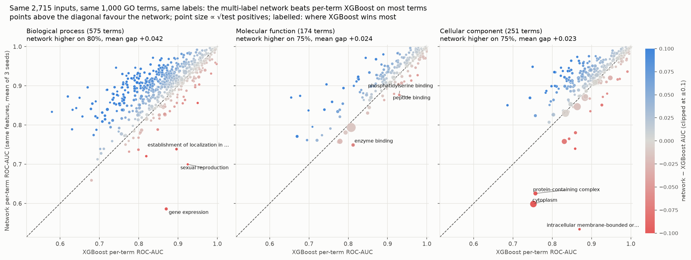
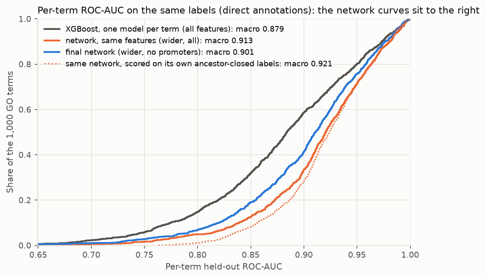
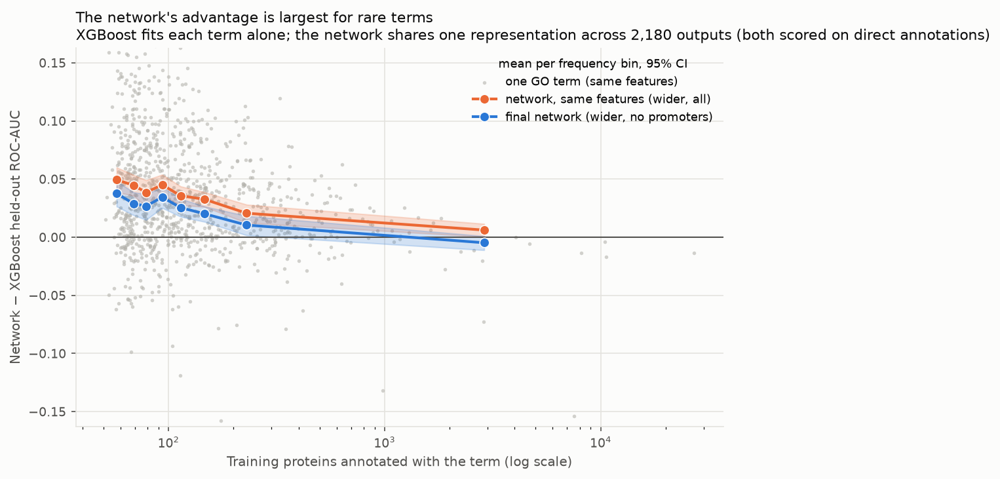
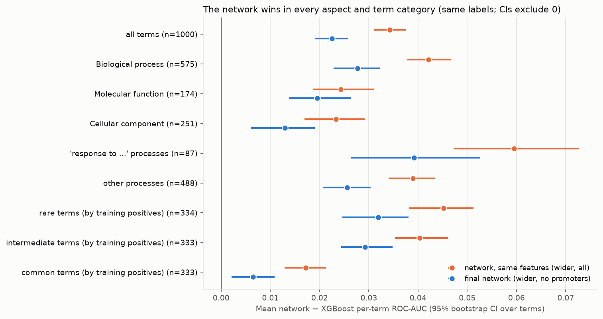
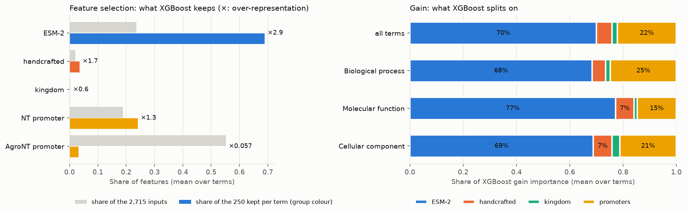

# Multi-label network vs per-term XGBoost

**Question:** how much does one multi-label network, predicting all 2,180 GO terms at once, gain
over the classic baseline of one XGBoost classifier per GO term?

**Answer:** with the same inputs, the same 1,000 GO terms and the same labels, the network's
macro ROC-AUC is **0.913 against 0.879 for XGBoost (+0.034)**. It's higher on 78% of terms
(Wilcoxon p = 5e-87).
- The final model (wider network, no promoters) still beats XGBoost by +0.023, even though
  XGBoost had the promoter inputs and it didn't.
- The gain is largest for rare terms (+0.045), where XGBoost has few positives to learn from
  alone. On the most common third of terms it shrinks to +0.017.



## Setup

| | XGBoost baseline | Network |
|---|---|---|
| Inputs | 2,715: ESM-2 150M (640), handcrafted (56), kingdom (7), NT promoter (512), AgroNT promoter (1,500) | the same 2,715 for the matched comparison; the final model drops the promoters (703) |
| Model | one `XGBClassifier` per term, 500 trees | one network, 2,180 sigmoid outputs (1,000 terms plus their ancestors) |
| Feature handling | LightGBM selection keeps 250 inputs per term | per-group projections into a shared MLP trunk |
| Tuning | per-term grid over depth {5, 7, 9} × learning rate {0.05, 0.1}, 3-fold CV on a ≤10k-protein positive-biased subsample | one architecture for all terms ([architecture search](../hparam-search/README.md)) |
| Labels | direct annotations from `train_terms.tsv` | ancestor-closed annotations |
| Training proteins | the full 80% training split | 85% of the training split (15% held out for early stopping) |
| Holdout | random 20% (seed 42) | random 20% (seeds 0, 1, 2; mean reported) |

Both models use the same split function, so the holdouts are equally sized random samples of
the same proteins.

**Same labels.** XGBoost is trained and scored on direct annotations. The network is trained on
ancestor-closed labels, so a general term like *cytoplasm* has many more positives for the
network. Every number here re-scores the network's saved test predictions against **direct
annotations**, the labels XGBoost is scored on.
- This is the conservative choice, because the network is graded on labels it wasn't trained
  for.
- On its own ancestor-closed labels the matched network scores 0.921, not 0.913 (dotted line
  below).

## Results

| Network | Network macro AUC | XGBoost macro AUC | Mean gap [95% CI] | Median gap | Terms network wins | Wilcoxon p |
|:--|--:|--:|:--|--:|:--|--:|
| network, same features (wider, all) | 0.913 | 0.879 | +0.034 [0.031, 0.037] | +0.026 | 78% | 5e-87 |
| network, default architecture, all features | 0.907 | 0.879 | +0.028 [0.024, 0.031] | +0.020 | 71% | 6e-59 |
| final network (wider, no promoters) | 0.901 | 0.879 | +0.023 [0.019, 0.026] | +0.018 | 69% | 8e-45 |

The CI is a bootstrap over terms. Network AUCs are the mean of 3 seeds. The median per-term sd
across seeds is 0.016, and the matched gap exceeds twice the seed sd on 49% of terms.



### Where the network gains most

| Terms | n | Same features | Final model |
|:--|--:|:--|:--|
| all terms | 1000 | +0.034 [0.031, 0.037], wins 78% | +0.023 [0.019, 0.026], wins 69% |
| Biological process | 575 | +0.042 [0.038, 0.047], wins 80% | +0.028 [0.023, 0.032], wins 70% |
| Molecular function | 174 | +0.024 [0.019, 0.031], wins 75% | +0.019 [0.014, 0.026], wins 70% |
| Cellular component | 251 | +0.023 [0.017, 0.029], wins 74% | +0.013 [0.006, 0.019], wins 63% |
| 'response to ...' processes | 87 | +0.060 [0.047, 0.073], wins 90% | +0.039 [0.026, 0.053], wins 77% |
| other processes | 488 | +0.039 [0.034, 0.043], wins 79% | +0.026 [0.021, 0.030], wins 69% |
| rare terms (by training positives) | 334 | +0.045 [0.038, 0.051], wins 81% | +0.032 [0.025, 0.038], wins 72% |
| intermediate terms | 333 | +0.040 [0.035, 0.046], wins 80% | +0.029 [0.024, 0.035], wins 75% |
| common terms | 333 | +0.017 [0.013, 0.021], wins 73% | +0.007 [0.002, 0.011], wins 59% |

- **Every category favours the network,** and no 95% CI includes zero.
- **Rare terms gain most.** XGBoost sees each term's few dozen positives in isolation. The
  network's shared trunk learns from all 2,180 outputs at once, so a rare term borrows signal
  from related terms. On the most common terms, the final model and XGBoost are nearly level
  (+0.007).
- **"Response to …" processes show the largest gap** (+0.060). These are the hardest terms for
  both models (XGBoost macro 0.81). The [feature ablation](../feature-ablation.md) found these
  terms gain most from promoters, and the network uses that signal better than per-term trees.
- **Biological process gains more than function or location.** BP terms are the most numerous
  and the most correlated with each other, which is where multi-task sharing pays off.





### Where XGBoost wins

The terms where XGBoost wins most are mostly very general ones, where the two label definitions
disagree most:

| term | name | test positives (XGBoost) | XGBoost AUC | network AUC |
|:--|:--|--:|--:|--:|
| GO:0043231 | intracellular membrane-bounded organelle | 27 | 0.869 | 0.534 |
| GO:0010467 | gene expression | 76 | 0.870 | 0.586 |
| GO:0019953 | sexual reproduction | 15 | 0.925 | 0.700 |
| GO:0051649 | establishment of localization in cell | 34 | 0.896 | 0.738 |
| GO:0005737 | cytoplasm | 1894 | 0.752 | 0.598 |
| GO:0032991 | protein-containing complex | 239 | 0.757 | 0.625 |

Few proteins are annotated *directly* to "intracellular membrane-bounded organelle". Thousands
inherit it through descendants such as nucleus or mitochondrion. The network ranks all of those
highly, as CAFA scoring wants, so it does badly on the narrow direct-annotation label. These
losses are an artefact of how XGBoost's labels are defined, not a weakness of the network.

The network's biggest wins are specific, rare terms where XGBoost is near chance:

| term | name | test positives (XGBoost) | XGBoost AUC | network AUC |
|:--|:--|--:|--:|--:|
| GO:0070417 | cellular response to cold | 11 | 0.579 | 0.834 |
| GO:0030010 | establishment of cell polarity | 19 | 0.620 | 0.873 |
| GO:0048678 | response to axon injury | 20 | 0.670 | 0.896 |
| GO:0001541 | ovarian follicle development | 13 | 0.649 | 0.870 |
| GO:0008092 | cytoskeletal protein binding | 16 | 0.655 | 0.870 |
| GO:0051276 | chromosome organization | 14 | 0.632 | 0.839 |

### What XGBoost uses



- **ESM-2 dominates XGBoost too:** 69% of the 250 kept features (2.9× its share of the inputs)
  and 70% of gain.
- **NT promoter dimensions are kept at about their input share** (×1.3) and carry 19% of gain,
  most in biological process (21%), where the [ablation](../feature-ablation.md) also found
  promoters help most.
- **AgroNT is almost never kept** (×0.06). It's zero outside plants, so it rarely ranks among a
  term's top 250.
- **Handcrafted features punch above their weight** (×1.7 selection, 6% of gain from 2% of
  inputs). Kingdom is rarely selected but carries 2% of gain when it is.

## Caveats

- **ROC-AUC only.** The XGBoost run did not save its models or predictions, so there's no CAFA
  Fmax, official CAFA6 score or protein-level paired test for the baseline. Rerunning XGBoost on
  the network's seed-0 split with saved predictions would allow both.
- **Proteins are not paired.** The holdouts are different random 20% samples, so the comparison
  is paired by term. Holdout noise averages out over 1,000 terms: the matched network's macro
  AUC varies by only 0.001 (sd) across its three seeds, each with a different split, against a
  0.034 gap. Individual rare terms, with about 10 test positives, are noisy.
- **XGBoost was tuned per term, but cheaply.** The grid searched only depth and learning rate on
  a subsample, with selection fixed at 250 features. Depth 9, the edge of the grid, was chosen
  for 389 of 1,000 terms, so deeper trees might help a little. Its mean CV AUC (0.871) is close
  to its test AUC (0.879), so it isn't overfitting the grid.
- **Training data favours XGBoost:** it trained on all 80% of training proteins, against 68% for
  the network.
- **Scored on XGBoost's labels.** The network is graded on direct annotations, a target it
  wasn't trained for. On its own labels its lead is larger (0.921 vs 0.879).

## Reproduce

```bash
uv run cafa6-train-go-models --top-n 1000 --output-dir data/models/go_term_xgboost_1000   # ~2-3 min per term
uv run python -m modeling.experiments.xgboost_baseline --xgb-dir data/models/go_term_xgboost_1000
```

The comparison reads `test_predictions.npz` and `test_nn_metrics.tsv` from the network runs in
`data/final/` and `data/ablation/feature-groups/all/`.

| File | Contents |
|---|---|
| `per_term_auc.csv` | every term: name, aspect, positives, XGBoost test and CV AUC, chosen depth and learning rate. For each network: AUC on direct labels (mean, sd over seeds), AUC on its own closed labels, and the gap |
| `summary.csv` | per network and term category: macro AUCs, mean and median gap, bootstrap CI, win share, Wilcoxon p |
| `xgb_feature_groups.csv` | XGBoost by aspect and input group: share of kept features, share of gain, selection enrichment |
